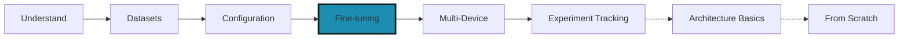

# Fine-tuning Basics

This lesson's title says "fine-tuning." Let's be precise about what that word means before running anything: **fine-tuning is continuing training from weights you already have, instead of starting from random numbers.** Mechanically, that's it — load a checkpoint, keep taking gradient steps, save a new checkpoint.

`train.py` (the trainer this whole track runs — see [Understanding Custom Training](command:tenstorrent.lesson.show?["ct1-understanding-training"])) supports that mechanic directly: `--resume <checkpoint>` loads a saved model and keeps training it; `--fresh` throws that away and starts from random initialization. There's no pretrained checkpoint for this particular architecture sitting on the internet waiting to be downloaded, so this lesson builds one first with a short run, then does the thing the title promises: **continues training that checkpoint instead of restarting it.** That continue-from-a-checkpoint command is exactly what you'd run against a real pretrained model, too — same flags, same mechanic, different starting weights.

Every number and every generated sample below is copied verbatim from a real training run against this extension's verified `ttml` build, on a Blackhole<sup>®</sup> p300c. Nothing here is projected or rounded to a nicer-looking curve.

## What You'll Learn

- Building `ttml` (tt-train's Python bindings) and running its verified trainer, `train.py`
- Watching a real cross-entropy loss curve drop, step by step, on Tenstorrent hardware
- The actual mechanic behind "fine-tuning": `--resume` a checkpoint instead of `--fresh`-starting one, and what a resumed loss curve looks like
- Reading generated text honestly: what a ~10.8M-parameter character model can and can't do after a few thousand steps
- The one flag people expect that doesn't exist (`--learning_rate`), and where `lr` actually lives

**Time:** 20-25 minutes | **Prerequisites:** [Configuration Patterns](command:tenstorrent.lesson.show?["ct3-configuration-patterns"]) (the YAML this lesson runs), a Shakespeare corpus from [Dataset Fundamentals](command:tenstorrent.lesson.show?["ct2-dataset-fundamentals"])

---

## Where This Fits in the Track



---

## Install `ttml`

`ttml` is source-only — there's no pip wheel. If you don't already have a built `~/tt-metal` source tree, do [Build TT-Metalium<sup>™</sup> from Source](command:tenstorrent.lesson.show?["build-tt-metal"]) first. This matters especially on a TT-QuietBox<sup>®</sup> 2: those images have no `~/tt-metal` at all — TT-NN<sup>™</sup> arrives as a container (`tt-metalium`) rather than on the host, so there's nothing to build `ttml` against until you make a source tree yourself.

Once you have a tt-metal build, this extension's **Install tt-train** command builds `ttml` for you:

[📦 Install tt-train](command:tenstorrent.training.installTtTrain)

Behind that button: configuring tt-train as a tt-metal subproject, building the `_ttml` Python bindings, then **rebuilding `ttnn`'s `_ttnn.so`** and wiring `ttml` onto your Python environment with a `.pth` file (there's no `tt-train/pyproject.toml`, so `pip install .` doesn't apply). That rebuild step is the fix for `import ttml` raising `std::bad_cast` — every pre-built tt-metal image, including TT-QuietBox 2's, ships an `_ttnn.so` built before `tt-train` was enabled, and the two binaries disagree about the shape of `ttnn`'s enum registry until you rebuild one against the other. The full recipe, with every gotcha hit during verification, lives in [`content/templates/llm-from-scratch/BUILD_TTML.md`](https://github.com/tenstorrent/tt-vscode-toolkit/blob/main/content/templates/llm-from-scratch/BUILD_TTML.md).

**How long this takes:** with a warm ccache, this build takes about 5 minutes. If this is your first-ever `tt-metal` build — no ccache yet — budget far longer; see [Build TT-Metalium from Source](command:tenstorrent.lesson.show?["build-tt-metal"]) before you start the clock.

Verify it worked:

```bash
python -c "import ttnn, ttml; print('ttml + ttnn OK')"
```

---

## The Config This Lesson Runs

[Configuration Patterns](command:tenstorrent.lesson.show?["ct3-configuration-patterns"]) already walked the real YAML files `train.py` reads. This lesson runs the one it falls back to when you pass no `--config` at all: `training_shakespeare_nanogpt_char.yaml`, paired with the model config `nanogpt_char.yaml`.

The shapes that matter:

| Setting | Value |
|---|---|
| Architecture | 6 transformer blocks, 384-dim embeddings, 6 attention heads, 256-token context |
| Parameters | 10,819,584 |
| Tokenizer | Character-level — vocabulary auto-detected from the text, then rounded up to a tile-friendly 96 |
| Optimizer | AdamW, `lr: 0.0003`, `weight_decay: 0.01` |
| Batch size | 64 |
| Checkpoint interval | every 500 steps (`model_save_interval: 500`) |
| Device mesh | `[1, 1]` — single chip. p300c and p100 both count as one chip here, exactly like n150 |

Set your environment the way [Train It & Run for Real](command:tenstorrent.lesson.show?["lfs-05-train-and-run"]) does — honoring a user-supplied `TT_METAL_ARCH_NAME` instead of overwriting it:

```bash
export TT_METAL_HOME="${TT_METAL_HOME:-$HOME/tt-metal}"
export TT_METAL_RUNTIME_ROOT="$TT_METAL_HOME"
: "${TT_METAL_ARCH_NAME:=wormhole_b0}"   # set to blackhole for p100 / p150 / p300c
export TT_METAL_ARCH_NAME
export TT_LOGGER_LEVEL=FATAL
cd ~/tt-metal/tt-train/sources/examples/train
```

You'll also want the Shakespeare corpus from [Dataset Fundamentals](command:tenstorrent.lesson.show?["ct2-dataset-fundamentals"]) at `~/tt-scratchpad/training/data/shakespeare.txt`. (`tt-metal` also ships its own copy of the same tiny-shakespeare corpus at `tt-train/data/shakespeare.txt`, which is what the verified run below actually used — either path works, it's the same text.)

---

## Run 1: Build a Checkpoint

There's no pretrained checkpoint for this architecture to fine-tune yet, so the first run makes one — a fresh start, from random weights:

```bash
python train.py \
  --config training_shakespeare_nanogpt_char.yaml \
  --data_path ~/tt-scratchpad/training/data/shakespeare.txt \
  --max_steps 3000 \
  --fresh \
  --checkpoint-dir ~/tt-metal/tt-train/checkpoints --checkpoint-prefix ct4_shakespeare
```

`--fresh` is the flag that matters here: it says "ignore any existing checkpoint, start from random initialization." That's the opposite of fine-tuning — and it's the right choice for this first run, since there's nothing yet to fine-tune.

### The real loss curve

This ran on a Blackhole p300c with tt-metal v0.82.0 (2026-11-24). Total wall clock: **3 minutes 40 seconds** (219.9 s), including a one-time ~11 second kernel-compile on the very first step. Steady state after that: **~70 ms/step, ~236,000 tokens/sec, ~17 TFLOPS, ~11% MFU.**

| Step | Loss | Checkpoint written |
|---|---|---|
| 1 | 4.688 | — |
| 500 | 2.234 | `ct4_shakespeare_step_500.pkl` |
| 1000 | 1.750 | `ct4_shakespeare_step_1000.pkl` |
| 1500 | 1.461 | `ct4_shakespeare_step_1500.pkl` |
| 2000 | 1.375 | `ct4_shakespeare_step_2000.pkl` |
| 2500 | 1.344 | `ct4_shakespeare_step_2500.pkl` |
| 3000 (final) | 1.258 | `ct4_shakespeare_final.pkl` |

Each value is the loss of that single training batch, so it moves a few hundredths from batch to batch. The run's average loss over all 3000 steps was 1.710. An earlier version of this lesson, measured on tt-metal v0.73, ended at 1.406 at step 3000. The two numbers come from different tt-metal releases and different trainer scripts, so they are not a like-for-like comparison.

Loss 4.688 at step 1 is close to `ln(96)` ≈ 4.56 — the entropy of guessing uniformly at random among 96 possible next characters. That's the honest random baseline this model started from. By step 3000 it has cut that error by almost three-quarters. `model_save_interval: 500` is why a checkpoint lands on disk every 500 steps automatically — you don't have to ask for it.

---

## Watch It Learn: Real Checkpoints, Real Generations

Because checkpoints were saved every 500 steps, you can generate from *several points along the same run* and watch the model change — without running training three separate times. Same prompt, same sampling settings, three different checkpoints:

```bash
python train.py \
  --prompt "ROMEO:" \
  --model_path ~/tt-metal/tt-train/checkpoints/ct4_shakespeare_step_500.pkl \
  --max_new_tokens 400 --temperature 0.8 --top_k 40
```

**Step 500 (loss 2.234) — actual output:**
```
Epmitharsaapksbaswithblmimactondanbleadem siseat,
Sherand thid ande ofor has,
He butor whild 'the wofordits:
On lot I
She the fry frut tleald shit whir ard nich,
Whars fjom of the an unors and weank her ouckg fee be
Af sors on irung sithance beang and sof ore af
Hand of bugend and hig vent loas hof diesh habull
Th wef the bed hine that brind and did fasthe ith,
And Tond keas hat beatr enenn a nan
```

**Step 1500 (loss 1.461) — actual output** (same command, `_step_1500.pkl`):
```
tpfItdsto apfaccush be mindeed,
I bloody do south my hands down furth:
Now, in where I'll wich be me our thanks to lieght to-hear from them;
But the cry think of thy frijoy:
Therefore is were I would that I good him
And so so with his glant to them to speak the sun,
Now not before in their love honours,
That which we way to dead of patriby.

LEONTES:
I have a moon too confess be bearry not made
I
```

**Step 3000 (loss 1.258) — actual output** (same command, `_final.pkl`):
```
hII labroad
a bawwitter house we absended soul,
He hath breathe furnice bell'd with this mani's tears.

POLIXENES:
My gracious lords,
Nollow on it what are nice,
Who should be dream'd out of my bonny too to grieve,
Or how should unhope banish'd in the state
Of whose most more marriage want like how lives haste?
Ready way to deliver and thy dear condemands
With down with a kingdom of request a want
```

### Read this honestly

Do **not** read this as "the model has learned to write Shakespeare." At step 500 the text is invented syllables. By step 1500 most words are real English ("bloody", "hands", "thanks", "honours"), and by step 3000 the text has speaker names ("POLIXENES:"), line breaks and verse-like lines. The sentences still do not mean anything: "He hath breathe furnice bell'd with this mani's tears" is grammatical in shape and meaningless in content, and some words are still invented ("condemands", "unhope"). At loss 1.26, on a 10.8M-parameter character model trained for under four minutes, the model has learned spelling and the layout of a play script. It has not learned to write coherent text, and this lesson does not claim it has. Readable, coherent language takes a much larger model, much more data and far more compute than this lesson runs.

One more note: the first few characters of each sample are garbage ("hII labroad", "tpfItdsto apfaccush"). `sample_greedy` left-pads the short `"ROMEO:"` prompt with spaces to fill the model's 256-character context window, and the model needs a few generated characters before the padding stops affecting its output. This is a property of the sampler, and it is not a training bug.

---

## Run 2: Continue Training — What "Fine-tuning" Actually Does

Now the payoff. Instead of starting over, **continue** training the checkpoint you just built:

```bash
python train.py \
  --config training_shakespeare_nanogpt_char.yaml \
  --data_path ~/tt-scratchpad/training/data/shakespeare.txt \
  --resume ~/tt-metal/tt-train/checkpoints/ct4_shakespeare_final.pkl \
  --max_steps 3500 \
  --checkpoint-dir ~/tt-metal/tt-train/checkpoints --checkpoint-prefix ct4_shakespeare_ft
```

Three flags, and the difference between them is the whole lesson:

- **`--resume <path>`** — load this checkpoint's weights and keep training. Omit the path and drop `--fresh`, and `train.py` auto-detects the latest checkpoint at `--checkpoint-dir` for you.
- **`--fresh`** — the opposite: ignore any checkpoint, start from random weights. This is what Run 1 used.
- **`--model_path <path>`** — only for inference (`--prompt` + `--model_path`, no training). This is the flag Run 1's generation samples used above.

`--max_steps` is an **absolute** target, not "how many more steps" — `--max_steps 3500` after resuming from step 3000 trains 500 additional steps (`3500 - 3000`), not 3500 more.

### The real resumed loss curve

Resuming worked cleanly: `train.py` printed `ct4_shakespeare_final.pkl @ step 3000`, reloaded the model and the optimizer, and picked the run back up. The loss after resuming:

| Step | Loss |
|---|---|
| 3000 (pre-resume) | 1.258 |
| 3001 | 1.266 |
| 3002 | 1.297 |
| 3010 | 1.258 |
| 3050 | 1.305 |
| 3100 | 1.250 |
| 3200 | 1.266 |
| 3300 | 1.242 |
| 3400 | 1.258 |
| 3500 (final) | 1.227 |

There is no jump. The loss continues from where the first run stopped and keeps easing down. The 500 extra steps took 36.2 seconds, the same ~70 to 75 ms/step as Run 1.

**This changed between tt-metal releases.** On v0.73 this same resume jumped from a loss of 1.406 to over 3.0 and had not recovered 500 steps later, because that trainer's checkpoint held only the model's weights. AdamW's momentum and variance were recreated from zero, and the first steps overshot. On v0.82.0 the checkpoint also stores the optimizer state. The checkpoint's manifest has a `model` group and an `optimizer` group, and `--resume` restores both.

We checked this more strictly on a second run. We trained a nano Llama model for 1500 steps with a fixed seed and saved a checkpoint at step 1000. Resuming from that checkpoint produced the same loss, to six decimals, as the uninterrupted run for steps 1001 to 1019 (for example 0.953125, 0.968750, 0.972656). Resuming restores the random-number generator state as well as the optimizer.

Two practical consequences:

- If you are on v0.82.0 or later, you do not need a lower learning rate or a warmup just to continue a run of your own.
- If you are on an older release and see a spike right after `--resume`, the cause is the missing optimizer state. The checkpoint is fine.

### There is still no `--learning_rate` flag

If you want to try mitigating the spike above with a lower learning rate, you can't do it on the command line — as [Configuration Patterns](command:tenstorrent.lesson.show?["ct3-configuration-patterns"]) already established, `train.py` has no `--learning_rate` override. `lr` lives in the training config YAML's `optimizer:` block. To resume with a different learning rate, copy `training_shakespeare_nanogpt_char.yaml`, edit `optimizer.lr`, and point `--config` at your copy.

---

## What This Lesson Didn't Do (On Purpose)

This lesson resumed the **same** checkpoint on the **same** Shakespeare corpus — that's "continued pretraining," a clean way to see the resume mechanic without a second dataset in the way. Real fine-tuning usually swaps in a *different*, smaller, task-specific dataset at the `--resume` step — same three flags, same mechanic, just a different `--data_path`. Once you're comfortable with the loss curve above, that swap is the only thing that changes.

If you want the deeper story — a transformer built and trained entirely from random initialization, with the architecture-capacity questions that come with it — that's [Training from Scratch](command:tenstorrent.lesson.show?["ct8-training-from-scratch"]). And if you want to build the trainer itself, gradient by gradient, instead of calling into `ttml`, that's [Train It & Run for Real](command:tenstorrent.lesson.show?["lfs-05-train-and-run"]) in the Build an LLM from Scratch track.

---

## Troubleshooting

### `ImportError: No module named 'ttml'` or `std::bad_cast` on `import ttml`

Covered above under **Install `ttml`** — the fix is rebuilding `_ttnn.so` after enabling tt-train, not a partial `--target _ttml` build. See `BUILD_TTML.md` for the full recipe.

### Loss spikes right after `--resume`

On tt-metal v0.82.0 and later this should not happen, because the checkpoint holds the optimizer state. If you see it, check which release you are on. On releases before v0.82.0 (v0.73 for example) the optimizer state is not restored, and a spike is expected. Give it a few hundred steps to settle, or resume with a lower `optimizer.lr` in your config.

### `RuntimeError: Device out of memory`

Reduce `--batch_size` (default here is 64, set in the YAML — override it on the command line, e.g. `--batch_size 32`).

### No checkpoint file after training

Make sure the checkpoint directory exists first — `train.py` doesn't create parent directories for `--checkpoint-dir`:

```bash
mkdir -p ~/tt-metal/tt-train/checkpoints
```

### `train.py --learning_rate ...` fails with "unrecognized arguments"

That flag doesn't exist — see **There is still no `--learning_rate` flag** above.

---

## Key Takeaways

- **Fine-tuning = continuing training from existing weights.** `--resume` does that; `--fresh` does the opposite.
- Real numbers from this p300c on tt-metal v0.82.0: loss `4.688 → 1.258` over 3000 steps, ~70 ms/step, 3 min 40 s total.
- On v0.82.0 a resumed run continues the loss curve with no spike, because the checkpoint stores the optimizer state and the random-number generator state. On v0.73 the optimizer state was not saved, and resuming produced a spike from 1.406 to over 3.0.
- At loss ~1.26 on a 10.8M-parameter character model, you get mostly real words, speaker names, colons and line breaks, but sentences that do not mean anything. Don't oversell what a short run at this scale produces.
- There is no `--learning_rate` flag. `lr` lives in the training config's `optimizer:` block.
- `model_save_interval` in the YAML plus `--checkpoint-dir` on the command line means you get multiple checkpoints from a single run for free — useful for watching a model change without re-running training.

---

## What's Next

Now that a single-chip run and the resume mechanic are both concrete, [Multi-Device Training](command:tenstorrent.lesson.show?["ct5-multi-device-training"]) scales the same `train.py` entry point across chips with Data Parallel. Or, if you'd rather stop guessing at loss numbers scrolling past in a terminal, [Experiment Tracking](command:tenstorrent.lesson.show?["ct6-experiment-tracking"]) captures runs like the two above to a file (or Weights & Biases) so you can compare them properly.

---

## Additional Resources

- [`train.py`](https://github.com/tenstorrent/tt-metal/blob/main/tt-train/sources/examples/train/train.py) — the trainer this lesson runs, in the `tt-metal` GitHub repository
- [tt-train source](https://github.com/tenstorrent/tt-metal/tree/main/tt-train) — the framework behind `ttml`
- [NanoGPT (Karpathy)](https://github.com/karpathy/nanoGPT) — the original architecture this example follows
