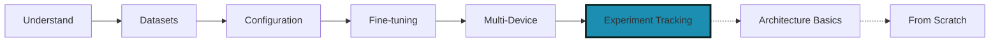

# Experiment Tracking

You've been running real `tt-train` jobs since [Fine-tuning Basics](command:tenstorrent.lesson.show?["ct4-finetuning-basics"]) — each one printing a wall of `Step: N, Loss: X` lines to your terminal and then scrolling out of view. This lesson is about not losing that signal: capturing it to a file, plotting it, comparing it across runs, and — if you want a dashboard instead of a CSV — bridging it to Weights & Biases.

## What You'll Learn

- What `train.py` actually prints, and how to capture it to a file
- Turning captured logs into a loss-curve plot
- Comparing hyperparameter runs (and which knobs you can actually vary from the CLI)
- Wiring your own runs up to Weights & Biases — honestly, given what `tt-train` does and doesn't do natively
- Naming, organizing, and not losing track of your checkpoints

**Time:** 10-15 minutes | **Prerequisites:** [Fine-tuning Basics](command:tenstorrent.lesson.show?["ct4-finetuning-basics"]) (produces the runs you'll track) and [Configuration Patterns](command:tenstorrent.lesson.show?["ct3-configuration-patterns"]) (the YAML this lesson's comparisons build on)

---

## Where This Fits in the Track



---

## Why Track Experiments?

Run a handful of training jobs with different hyperparameters and a familiar problem shows up fast:

```
Which batch size actually finished with the lower loss?
Did the run from this morning beat yesterday's?
What config produced that checkpoint sitting in ~/tt-metal/tt-train/checkpoints?
```

**Without tracking:** scroll back through terminal history, or don't — and just guess.

**With tracking:** every run's loss curve, config, and checkpoint path lives somewhere you can compare at a glance.

---

## What `tt-train` Actually Gives You

Before building anything, it's worth being precise about what `train.py` does on its own, because it's less than you might expect:

- **Per-step stdout, nothing more.** There's no `training.log`, no `validation.txt`, no auto-generated plot. Everything the trainer produces during a run, it prints to your terminal.
- **Checkpoints, on a schedule you control.** Pass `--checkpoint-dir`, and the trainer writes a `.pkl` checkpoint every `model_save_interval` steps (set in the training config's YAML) — see [Configuration Patterns](command:tenstorrent.lesson.show?["ct3-configuration-patterns"]) for how that field works.
- **No wandb calls in the code path you're running.** More on this below — it matters for what "tracking" honestly means here.

So the object you're building in this lesson is exactly one thing: **capture the stdout stream, and everything else (files, curves, dashboards) is something you construct from it.**

---

## Approach 1: File-Based Tracking (the real baseline)

### The real print statement

This is the code that prints the per-step line. It lives in `tt-train/sources/examples/train/callbacks.py` (tt-metal v0.82.0):

```python
line = f"Step: {step}, Loss: {step_loss:.6f}, Time: {elapsed_ms:.2f} ms, TPS: {tps:.0f}"
if self._flops_per_token > 0 and elapsed_ms > 0:
    achieved = tps * self._flops_per_token / 1e12
    line += f", TFLOPS: {achieved:.3g}"
    if self._peak_tflops > 0:
        mfu = achieved / self._peak_tflops * 100.0
        line += f", MFU: {mfu:.3g}%"
print(line)
```

`Step`, `Loss`, `Time` and `TPS` always print. `TFLOPS` and `MFU` (model FLOPs utilization) only appear for architectures where per-token FLOPs are known. Llama-family configs get both, and some other model types get a shorter line.

Here is the last line of a real 20-step run of the 9.81M-parameter Llama-style model from [Train It & Run for Real](command:tenstorrent.lesson.show?["lfs-05-train-and-run"]), on a Blackhole<sup>®</sup> p300c with tt-metal v0.82.0 (`config: training_shakespeare_nanollama3_char.yaml`, `batch_size: 64`, `max_sequence_length: 256`):

```
Step: 20, Loss: 3.234375, Time: 60.76 ms, TPS: 269659, TFLOPS: 17.7, MFU: 11.9%
```

The loss values at four steps of that run:

| Step | Loss |
|---|---|
| 1 | 4.843750 |
| 5 | 3.750000 |
| 10 | 3.359375 |
| 20 | 3.234375 |

The loss goes down over 20 steps on real hardware. Step 1 took 28.1 seconds because of the one-time kernel compile on a cold kernel cache. A repeat run later the same day took 3.2 seconds for step 1. Every step after the first ran in about 59 ms. The lesson is about capturing and comparing this signal.

### Capture it

Redirect stdout with `tee` so you see the run live *and* keep a copy:

```bash
cd ~/tt-metal/tt-train/sources/examples/train

mkdir -p ~/tt-scratchpad/runs
python train.py \
  --config training_shakespeare_nanollama3_char.yaml \
  --max_steps 500 \
  --checkpoint-dir ~/tt-metal/tt-train/checkpoints --checkpoint-prefix tracking_baseline \
  2>&1 | tee ~/tt-scratchpad/runs/2026-07-09_baseline.log
```

### Organize by run, not by output directory

```
~/tt-scratchpad/runs/
  2026-07-09_baseline.log
  2026-07-09_baseline.yaml          # copy of the training config used
  2026-07-09_batch32.log
  2026-07-09_batch32.yaml
```

Copy the config alongside its log — `tt-train` doesn't do this for you, and a log file without its config is much less useful six weeks from now.

### Parse the log into a loss curve

A small, dependency-light script that pulls `Step`/`Loss`/`TPS`/`TFLOPS` out of any captured log and plots it:

```python
#!/usr/bin/env python3
"""plot_run.py — parse train.py stdout and plot the loss curve.

Usage: python plot_run.py run1.log [run2.log ...]
"""
import re
import sys
import matplotlib.pyplot as plt

LINE_RE = re.compile(
    r"Step:\s*(\d+),\s*Loss:\s*([\d.]+),\s*Time:\s*([\d.]+)\s*ms"
    r"(?:,\s*TPS:\s*([\d.]+))?(?:,\s*TFLOPS:\s*([\d.]+))?(?:,\s*MFU:\s*([\d.]+)%)?"
)

def parse_log(path):
    steps, losses = [], []
    with open(path) as f:
        for line in f:
            m = LINE_RE.search(line)
            if m:
                steps.append(int(m.group(1)))
                losses.append(float(m.group(2)))
    return steps, losses

if __name__ == "__main__":
    for path in sys.argv[1:]:
        steps, losses = parse_log(path)
        if not steps:
            print(f"warning: no Step/Loss lines found in {path}")
            continue
        plt.plot(steps, losses, label=path.split("/")[-1])
        print(f"{path}: {len(steps)} steps, final loss {losses[-1]:.4f}")

    plt.xlabel("Step")
    plt.ylabel("Loss")
    plt.title("tt-train loss curve(s)")
    plt.legend()
    plt.savefig("loss_curve.png")
    print("Saved loss_curve.png")
```

Run it against one or several logs — passing multiple files overlays them on the same axes, which is exactly what you want for the comparisons below.

```bash
python plot_run.py ~/tt-scratchpad/runs/2026-07-09_baseline.log
```

---

## Comparing Hyperparameter Runs

[Configuration Patterns](command:tenstorrent.lesson.show?["ct3-configuration-patterns"]) established which fields `train.py` actually lets you override from the command line: `--data_path`, `--batch_size`, `--max_steps`, `--epochs`, `--max-grad-norm`, `--sequence_length`, `--checkpoint-dir`. **Learning rate is not one of them** — `lr` only lives in the training config YAML's `optimizer:` block.

That split determines how you run a comparison:

### Batch size — a CLI flag away

```bash
python train.py --config training_shakespeare_nanollama3_char.yaml \
  --batch_size 32 --max_steps 200 \
  2>&1 | tee ~/tt-scratchpad/runs/batch32.log

python train.py --config training_shakespeare_nanollama3_char.yaml \
  --batch_size 64 --max_steps 200 \
  2>&1 | tee ~/tt-scratchpad/runs/batch64.log

python plot_run.py ~/tt-scratchpad/runs/batch32.log ~/tt-scratchpad/runs/batch64.log
```

Two log files, one plot, one command each — no config edits needed.

### Learning rate — needs a second config file

Since `lr` can't be overridden on the command line, comparing learning rates means copying the training config and editing `optimizer.lr` in the copy, the same pattern [Configuration Patterns](command:tenstorrent.lesson.show?["ct3-configuration-patterns"]) walks through for the model/training config split:

```bash
cp ~/tt-metal/tt-train/configs/training_configs/training_shakespeare_nanollama3_char.yaml \
   ~/tt-scratchpad/runs/lr_1e-4.yaml
# edit optimizer.lr: 0.0001 in the copy

python train.py --config ~/tt-scratchpad/runs/lr_1e-4.yaml --max_steps 200 \
  2>&1 | tee ~/tt-scratchpad/runs/lr_1e-4.log
```

Run the same for a second `lr` value, then feed both logs to `plot_run.py` to see which one drops faster.

### Reading what comes out

Once you've got two or more logs, the comparison is just: lower final loss, at the same step count, wins — with an eye on `TPS`/`TFLOPS` too, since a run that's 2x slower per step needs a correspondingly larger win to be worth it.

---

## Approach 2: Weights & Biases — Honestly

`tt-train`'s top-level README does describe wandb integration, and tells you how to opt *out* of it: pass `-w 0`, or run `wandb offline` beforehand. There's even a vendored `wandb-cpp` library in `tt-train/3rd_party/`.

Here's the honest part: **that flag and that vendored library aren't wired into the trainer you're actually running.** Neither `train.py`'s argument parser nor its training loop calls into wandb anywhere — `-w` isn't a recognized flag on the Python trainer, and `project_name` in the training config is used only to name the checkpoint directory (as [Configuration Patterns](command:tenstorrent.lesson.show?["ct3-configuration-patterns"]) found when it went looking for a wandb field in the YAML schema and came up empty). The README describes an integration point that exists in the repo's history and docs, not in this code path today.

That doesn't make wandb pointless here — it means you build the bridge yourself, which is a dozen lines on top of the exact log you're already capturing:

```python
#!/usr/bin/env python3
"""wandb_bridge.py — tail a train.py log and mirror it into wandb.

Usage: python wandb_bridge.py run.log --project my-tt-train-project
"""
import argparse
import re

import wandb

LINE_RE = re.compile(
    r"Step:\s*(\d+),\s*Loss:\s*([\d.]+),\s*Time:\s*([\d.]+)\s*ms"
    r"(?:,\s*TPS:\s*([\d.]+))?(?:,\s*TFLOPS:\s*([\d.]+))?(?:,\s*MFU:\s*([\d.]+)%)?"
)

def main():
    ap = argparse.ArgumentParser()
    ap.add_argument("log_path")
    ap.add_argument("--project", default="tt-train")
    ap.add_argument("--offline", action="store_true", help="Log locally, no network")
    args = ap.parse_args()

    run = wandb.init(project=args.project, mode="offline" if args.offline else "online")
    with open(args.log_path) as f:
        for line in f:
            m = LINE_RE.search(line)
            if not m:
                continue
            step, loss, time_ms, tps, tflops, mfu = m.groups()
            payload = {"loss": float(loss), "time_ms": float(time_ms)}
            if tps:
                payload["tps"] = float(tps)
            if tflops:
                payload["tflops"] = float(tflops)
            if mfu:
                payload["mfu_pct"] = float(mfu)
            wandb.log(payload, step=int(step))
    run.finish()

if __name__ == "__main__":
    main()
```

Run it against a completed log, or `tail -f` a live one into the same parser if you want it near-real-time. Either way, you get real wandb charts backed by real `tt-train` numbers — you just own the pipe between the two, instead of relying on a flag that isn't there.

### Verified: wandb offline needs no network

`wandb.init(mode="offline")` — the `--offline` flag above — writes run data to a local `wandb/` directory and never attempts a network call. This was confirmed directly: running the bridge script above with `mode="offline"` against a sample log completes immediately and prints `W&B syncing is set to offline in this directory`, with a local run folder left behind and no connection attempt. That's the same effect as `tt-train`'s README-documented `wandb offline` command (which also just writes a local `wandb/settings` file) — useful if you're on an air-gapped box, or just don't want an account yet:

```bash
python wandb_bridge.py ~/tt-scratchpad/runs/2026-07-09_baseline.log --offline
```

When you're ready to see it on wandb.ai, drop `--offline`, `wandb login` once, and re-run — or `wandb sync` the offline run directory it already wrote.

---

## Visualizing and Comparing Runs

However you got the numbers — parsed log or wandb dashboard — the shapes to recognize are the same:

**Healthy:**
```
Loss
  4 |*
    | *
  3 |  **
    |    ***
  2 |       *****
    |            -------
  1 |___________________
    0   100   200   300   400   500
```
Smooth decrease, plateauing near the end.

**Overfitting (if you're holding out a validation split):**
```
Loss
  4 |*
    | *                  Train
  3 |  **  *****----
    |
  2 |       Val -------↗
    |
  1 |___________________
    0   100   200   300   400   500
```
Train keeps dropping; val turns upward. Stop earlier, or get more data.

**Underfitting:**
```
Loss
  4 |*  **  **  **  **
    |
  3 |
    |
  2 |
    |
  1 |___________________
    0   100   200   300   400   500
```
Barely moving. Try a higher `lr`, more steps, or a larger model — [Model Architecture Basics](command:tenstorrent.lesson.show?["ct7-architecture-basics"]) is where the "larger model" knobs actually live.

---

## Best Practices for Experiment Management

**Name runs so you can tell them apart later:**
```
Good:  2026-07-09_p300c_lr1e-4_batch64_baseline.log
Bad:   run3.log
```
Date, hardware, the hyperparameter you varied, and why — in the filename, not just in your memory.

**Keep the config next to the log.** A loss curve without the YAML that produced it is a curiosity, not a reproducible result.

**Version-control configs you care about:**
```bash
git add training_shakespeare_nanollama3_char_lr1e-4.yaml
git commit -m "Config for lr=1e-4 comparison run"
git tag exp-lr1e-4
```

**Don't delete failed runs.** A log where loss diverged at step 40 is exactly the evidence you'll want when someone (including future you) asks "didn't we already try that lr?"

**Clean up checkpoints deliberately, not accidentally.** `model_save_interval` in the training config controls how often `.pkl` files land on disk — for a long run that's a lot of checkpoints. Keep the final one and a couple of milestones; archive or delete the rest once you've confirmed the run's outcome.

---

## Key Takeaways

✅ **`train.py` gives you stdout and checkpoints — nothing else is automatic.** Files, curves, and dashboards are things you build on top of the print statement above.

✅ **Capture with `tee`, parse with a small regex, plot with matplotlib.** That's the whole file-based baseline, and it's the one guaranteed to work.

✅ **Seven fields are CLI-overridable; `lr` isn't.** Comparing batch size is a flag; comparing learning rate means a second config file.

✅ **wandb's `-w 0`/`wandb offline` opt-out is documented but the integration it opts out of isn't wired into the trainer you're running.** Bridge it yourself by parsing the same log — including in `--offline` mode, verified to need no network.

✅ **Name runs, keep configs with logs, don't delete failures.**

---

## Next Steps

You've covered the full loop: configure ([Configuration Patterns](command:tenstorrent.lesson.show?["ct3-configuration-patterns"])), run ([Fine-tuning Basics](command:tenstorrent.lesson.show?["ct4-finetuning-basics"]), [Multi-Device Training](command:tenstorrent.lesson.show?["ct5-multi-device-training"])), and now track.

**Next: [Model Architecture Basics](command:tenstorrent.lesson.show?["ct7-architecture-basics"])** — once you're comparing runs and asking "would a bigger model help here?", this is where you learn what's actually inside the `transformer_config:` block you've been editing: attention heads, embedding dimensions, block counts, and the trade-offs behind each.

**Or go all the way down:** if you'd rather see the loss curve you just plotted come from a training loop you wrote yourself — cross-entropy, backprop, `AdamW`, no framework hiding the mechanics — [Train It & Run for Real](command:tenstorrent.lesson.show?["lfs-05-train-and-run"]) is the from-scratch counterpart to this whole lesson: the exact captured run quoted above, built line by line.

---

## Additional Resources

### Weights & Biases
- [WandB Quickstart](https://docs.wandb.ai/quickstart) — official docs
- [WandB Offline Mode](https://docs.wandb.ai/guides/technical-faq/setup/#can-i-run-wandb-offline) — the mode used in this lesson's bridge script

### The real source
- `tt-train/sources/examples/train/callbacks.py` — the code that prints this lesson's log format, verbatim
- `tt-train/README.md` — documents the `-w 0`/`wandb offline` opt-out this lesson cross-checked against the actual code

### Visualization
- [Matplotlib tutorials](https://matplotlib.org/stable/tutorials/index.html) — the plotting library used above
- [DVC](https://dvc.org/) — a heavier-weight, local-first alternative if file-based tracking outgrows a directory of logs
